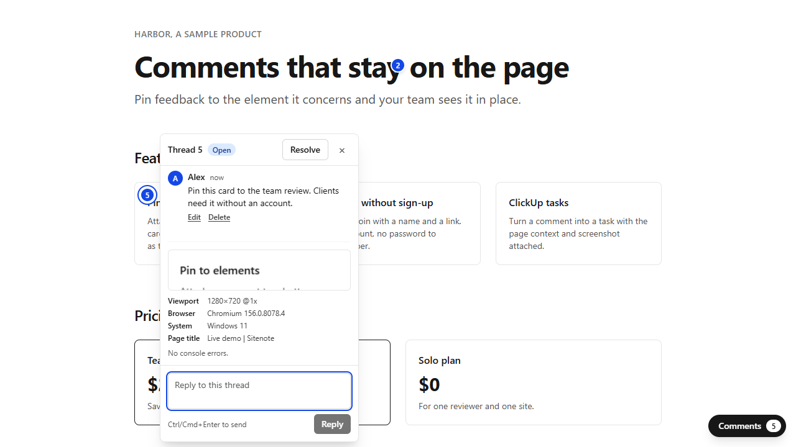
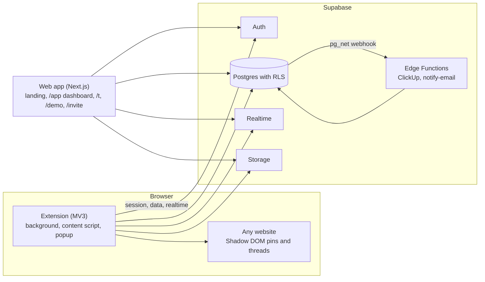

# Sitenote

Figma-style comments on any live website.

Click an element or select text, drop a pin, and discuss it in a thread with your team. Every comment carries a screenshot, viewport, browser and console errors, links straight back to the exact spot on the page, and turns into a ClickUp task in one click.

[](https://<your-domain>/demo)

> Live demo: `https://<your-domain>/demo` (placeholder until the first deploy). The demo runs on a sample page and needs no account.
>
> Status: in development. See [the implementation plan](docs/plans/2026-10-20-sitenote-implementation.md).

## Features

- Pin comments to a DOM element or to a text selection
- Threads with replies, @mentions and Open / Resolved status, updated live for everyone on the page
- Team workspaces and guest access for clients via invite link, no sign-up
- Automatic context: element screenshot, viewport and breakpoint, browser, recent console errors
- Deep links to a single comment that open the page and scroll to the pin
- Web dashboard with every comment across sites and pages
- ClickUp: create a task from a comment with a link back to the pin
- Email notifications for replies and mentions
- Live demo page that works without installing the extension

## Architecture



The workspace packages are shared by the extension and the web app: `@sitenote/core` (anchoring engine, shared types, data access), `@sitenote/db` (generated database types and the Supabase client), `@sitenote/ui` (pins, threads and composer) and `@sitenote/widget` (the comment widget mounted by the extension and by the demo).

## Tech stack

| Layer | Tech |
|---|---|
| Extension | WXT (Manifest V3), React 19, TypeScript, Tailwind 4, Shadow DOM |
| Web | Next.js (App Router), React 19, TypeScript, Tailwind 4 |
| Backend | Supabase: Auth, Postgres with RLS, Realtime, Storage, Edge Functions (Deno) |
| Integrations | ClickUp API, Resend |
| Tooling | pnpm workspaces, Turborepo, Vitest, Playwright, GitHub Actions |

## Local setup

Requirements: Node 24 (see `.nvmrc`), pnpm 11, and Docker for the local Supabase stack.

```bash
pnpm install
pnpm db:start        # local Supabase: applies migrations and supabase/seed.sql
pnpm db:env          # writes .env.local for the web app, the extension and the tests
pnpm dev             # web app on http://localhost:3000, extension dev server on port 3100
```

Seeded users (`owner@`, `member@`, `guest@`, `outsider@sitenote.test`) sign in with the password `sitenote-dev-password`. Local e-mails land in Mailpit at http://127.0.0.1:54324.

To load the extension, build it and open `chrome://extensions`, turn on Developer mode and choose Load unpacked on `apps/extension/.output/chrome-mv3`:

```bash
pnpm --filter @sitenote/extension build
```

Without Docker, develop against a cloud Supabase project instead: run `supabase link`, `supabase db push` and `supabase config push`, copy `.env.cloud.example` to `.env.cloud`, fill it in, and run `pnpm db:env:cloud`. `.env.cloud` holds secrets and stays out of git.

`pnpm db:stop` stops the local stack. `pnpm db:reset` re-applies migrations and the seed, and `pnpm db:types` regenerates `packages/db/src/database-types` after a migration.

## Testing

| Command | What it covers |
|---|---|
| `pnpm test` | Vitest projects: web and extension components (happy-dom), ui and widget components, core (Node and browser mode), root scripts and Edge Function helpers |
| `pnpm test:rls` | Row-level security tests against the running local stack |
| `pnpm db:lint` | `supabase db lint` on the migrations |
| `deno test --config supabase/functions/deno.json ...` | Edge Function handlers (run in the Functions CI job) |
| `pnpm e2e` | Playwright: landing, web app, demo, invites, ClickUp, extension comment loop and context capture on the fixture site |
| `pnpm lint`, `pnpm typecheck`, `pnpm format:check` | ESLint, TypeScript strict, Prettier |
| `pnpm check:manifest` | The production manifest has no host permissions at install time |

`pnpm e2e` needs the local stack and the environment from `pnpm db:env`. The GitHub Actions workflow `CI` runs the checks, the database job, the Edge Function tests and the end-to-end suite on every pull request. The `Media` workflow is manual: it records the demo video, the landing poster and the Open Graph image (`pnpm media:record`) and uploads them as an artifact.

## Project structure

```
apps/
  extension/   browser extension: background, content script, popup
  web/         landing, dashboard, deep links, demo, invites
packages/
  core/        anchoring engine, shared types, data access
  db/          generated database types and Supabase client helpers
  ui/          pins, threads and composer shared by the extension and the demo
  widget/      comment widget mounted by the extension and the demo
  tsconfig/    shared TypeScript configs
e2e/           Playwright suites, fixture site, ClickUp mock, media recording
supabase/      migrations, RLS policies, seed, Edge Functions
docs/plans/    design and implementation plan
```

## Decisions

Every non-trivial choice is recorded in [DECISIONS.md](DECISIONS.md) with the alternatives and the reasons.

## Docs

- [Design](docs/plans/2026-10-20-sitenote-design.md)
- [Implementation plan](docs/plans/2026-10-20-sitenote-implementation.md)
- [Production deploy](docs/deploy.md)
- [Decisions](DECISIONS.md)
